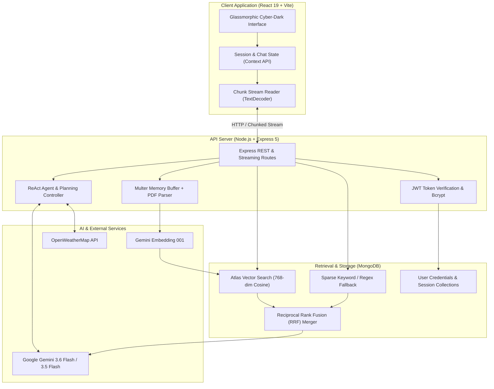

# 🚀 NexusAI — Autonomous Agent Orchestrator & Multimodal Hybrid RAG Platform

NexusAI is a full-stack, production-grade AI platform that bridges generative language models, autonomous tool-executing agents, and multi-strategy Retrieval-Augmented Generation (RAG). Built with an **Express 5** backend and a reactive **React 19** frontend, the system provides real-time streaming, in-memory PDF parsing, sliding-window chunking, vector-based semantic search with Reciprocal Rank Fusion (RRF), and multimodal vision intelligence.

---

## 📑 Table of Contents
- [Architecture Overview](#-architecture-overview)
- [Key Features](#-key-features)
- [Technical Stack](#-technical-stack)
- [System Design & Engineering Decisions](#-system-design--engineering-decisions)
- [Project Layout](#-project-layout)
- [Quickstart & Local Setup](#-quickstart--local-setup)
- [Environment Configuration](#-environment-configuration)
- [API Reference](#-api-reference)
- [License](#-license)

---

## 🏛️ Architecture Overview

NexusAI decouples client interactions, agent reasoning, and data retrieval into modular, observable layers:



---

## 🌟 Key Features

### 1. ⚡ Real-Time Streaming & Conversational AI
- **Chunked Transfer Encoding**: Low-latency, token-by-token streaming over standard HTTP without requiring heavy WebSocket overhead.
- **Context Preservation**: Multi-turn session persistence synchronized through LocalStorage and state hooks.
- **Markdown & Syntax Highlighting**: Real-time rendering of code snippets with PrismJS and GitHub-flavored markdown.

### 2. 🔍 Advanced Hybrid RAG Engine
- **Dense Vector Search**: Generates 768-dimensional embeddings using `gemini-embedding-001` stored in MongoDB Atlas.
- **Sparse Keyword Search**: Full-text and term-frequency search across indexed document segments.
- **Reciprocal Rank Fusion (RRF)**: Merges candidates from both dense and sparse retrieval pipelines:
  $$\text{RRF Score}(d) = \sum_{m \in M} \frac{1}{k + r_m(d)}$$
  *(where $k = 60$ balances ranks between dense semantic matches and exact keyword hits).*
- **Query Rewriting & Multi-Query Expansion**: Transforms colloquial prompts into 3 distinct search variations to maximize retrieval recall.

### 3. 🤖 ReAct Autonomous Agent & Planning Controller
- **Iterative Reasoning Loop**: Dynamic **Thought ➔ Action ➔ Observation ➔ Synthesis** cycle.
- **Extensible Tool Registry**: Dispatches tool calls deterministically (e.g., live weather queries, math operations).
- **Plan-and-Execute Engine**: Deconstructs multi-part queries into ordered, schema-validated execution steps before running them.

### 4. 📄 In-Memory Document Intelligence & Vision
- **Streamlined PDF Ingestion**: Processes PDFs directly in memory via `multer` buffers and `pdf-parse` without persistent disk clutter.
- **Sliding-Window Chunking**: 100-250 word chunks with configurable overlap to preserve boundary context.
- **Multimodal Vision**: Analyzes base64 image data and structured documents using Gemini multimodal capabilities.

### 5. 🔐 Enterprise Authentication
- **Secure Password Hashing**: Utilizes `bcrypt` with salt rounds for secure credential storage.
- **Stateless Authorization**: Signed JSON Web Tokens (JWT) verified via request interceptors and middleware.

### 6. 🪄 Prompt Engineering Studio & Optimization Lab
- **Battle-Tested Frameworks**: Optimizes casual prompts into structured prompts using **CO-STAR**, **Few-Shot Chain of Thought**, and **Strict Guardrails**.
- **Actionable Feedback**: Generates automated improvement breakdowns and suggested system variables.
- **Direct Chat Handoff**: One-click copying and seamless handoff of engineered prompts directly into the conversational chat stream.

---

## 🛠️ Technical Stack

| Layer | Technologies |
|---|---|
| **Frontend Client** | React 19, Vite 6, Lucide React, Marked, PrismJS, Vanilla Cyber-Glass CSS |
| **Backend Runtime** | Node.js (ES Modules), Express 5, `@google/genai` SDK, Mongoose 9 |
| **Data Processing** | Multer (Memory Storage), `pdf-parse`, Custom sliding-window chunker |
| **Database & Vector Index** | MongoDB Server / MongoDB Atlas Vector Search |
| **AI Models** | `gemini-3.6-flash-lite`, `gemini-3.5-flash`, `gemini-embedding-001` |
| **Containerization** | Docker, Docker Compose |

---

## 🧠 System Design & Engineering Decisions

### Why Hybrid RAG with Reciprocal Rank Fusion?
Dense vector search excels at conceptual and semantic similarity (e.g., matching "automobile maintenance" to "car repair"). However, it can struggle with exact identifiers, part numbers, or specific technical terms. 

NexusAI executes both dense vector search and sparse keyword queries simultaneously. The results are scored and interleaved via **Reciprocal Rank Fusion (RRF)**, ensuring the generative model receives context that is both semantically rich and keyword-accurate.

### Robust Fallback Architecture
If the backend connects to a standard local MongoDB instance without Atlas Vector Search indexes configured, the retrieval service automatically falls back to regex-anchored direct chunk retrieval and recent document scans. The application never crashes due to a missing vector index.

---

## 📁 Project Layout

```text
.
├── ai-express/                 # Backend REST & AI Orchestrator
│   ├── config/
│   │   ├── ai.js               # Google GenAI SDK configuration
│   │   └── db.js               # MongoDB connection logic
│   ├── controllers/
│   │   ├── ai.controllers.js   # Chat, RAG, search, agent & vision handlers
│   │   └── user.controller.js  # Registration & authentication handlers
│   ├── middlewares/
│   │   ├── Auth.js             # JWT verification middleware
│   │   └── upload.middleware.js# Memory storage upload handler
│   ├── models/
│   │   ├── User.model.js       # User schema & bcrypt pre-save hook
│   │   └── embedding.models.js # Chunk embeddings schema
│   ├── routes/
│   │   ├── ai.routes.js        # AI & RAG endpoints
│   │   └── User.routes.js      # Auth endpoints
│   ├── services/
│   │   ├── ai.services.js      # Agent loop, Gemini prompts, RAG logic
│   │   └── User.services.js    # Password hashing & JWT generation
│   ├── utils/
│   │   └── chunkText.js        # Word and character sliding chunkers
│   ├── package.json
│   └── server.js               # Application entry point
│
├── frontend/                   # React 19 Single Page Application
│   ├── src/
│   │   ├── api/
│   │   │   ├── auth.js         # Axios client with JWT interceptors
│   │   │   └── client.js       # Fetch client for chunked streams & endpoints
│   │   ├── components/
│   │   │   ├── AdvancedRAG/    # Hybrid RRF search explorer & inspector
│   │   │   ├── Auth/           # Login & registration views
│   │   │   ├── Chat/           # Conversational container & session timeline
│   │   │   ├── KnowledgeBase/  # Document uploader & chunk viewer
│   │   │   ├── Navigation/     # Sidebar & top header
│   │   │   ├── System/         # Latency telemetry & diagnostics
│   │   │   ├── Tools/          # Agent studio & tool tester
│   │   │   └── Vision/         # Multimodal image analysis
│   │   ├── context/            # Authentication Context Provider
│   │   ├── App.jsx             # Root layout & view router
│   │   ├── index.css           # Glassmorphism dark design system
│   │   └── main.jsx            # React root mount
│   ├── index.html
│   ├── package.json
│   └── vite.config.js          # Development server & proxy configuration
│
├── docker-compose.yml          # Container configuration
└── README.md                   # Documentation
```

---

## 🚀 Quickstart & Local Setup

### 1. Prerequisites
- **Node.js**: v18.0.0 or higher
- **MongoDB**: Local MongoDB instance running on port 27017 or a MongoDB Atlas cluster URI
- **Google AI Studio Key**: Free API key from [aistudio.google.com](https://aistudio.google.com/)

---

### 2. Configure Environment Variables

Create `.env` inside `ai-express/`:

```env
PORT=3000
MONGO_URL=mongodb://127.0.0.1:27017/ai_evaluation
GEMINI_API_KEY=your_google_gemini_api_key_here
AccKey=your_strong_jwt_secret_key
WEATHER_API_KEY=your_openweathermap_api_key_optional
```

---

### 3. Start Backend Service

```bash
cd ai-express
npm install
npm start
```
The backend initializes on `http://localhost:3000`.

---

### 4. Start Frontend Client

In a separate terminal:

```bash
cd frontend
npm install
npm run dev
```
Open your browser at **`http://localhost:5173`**.

---

### 5. (Alternative) Run with Docker

To build and spin up both services containerized:

```bash
docker compose up --build
```
- **Frontend Client**: `http://localhost:80`
- **Backend API**: `http://localhost:3000`

---

## 📡 API Reference

### 🔐 Authentication (`/api/auth`)

| Method | Route | Description |
|---|---|---|
| `POST` | `/api/auth/signup` | Registers user (`name`, `email`, `password`) |
| `POST` | `/api/auth/login` | Validates credentials and returns signed JWT |

---

### 💬 Conversational & Core AI (`/api/v1`)

| Method | Route | Description |
|---|---|---|
| `POST` | `/api/v1/chunk` | Streams token responses token-by-token (`{ message }`) |
| `POST` | `/api/v1/fast-chat` | Direct low-latency response using Gemini Flash |
| `POST` | `/api/v1/optimize-prompt` | Enhances raw prompts using CO-STAR & schema constraints |
| `POST` | `/api/v1/chat` | Extracts structured JSON tasks from natural language |
| `GET` | `/api/v1/health` | Service health status and uptime telemetry |

---

### 📚 Knowledge Base & Hybrid RAG (`/api/v1`)

| Method | Route | Description |
|---|---|---|
| `POST` | `/api/v1/upload-docs` | Uploads PDF, parses text in-memory, chunks, and indexes vectors |
| `POST` | `/api/v1/rag-ans` | Vector retrieval over indexed documents with synthesized answer |
| `POST` | `/api/v1/rrf` | Executes Reciprocal Rank Fusion combining vector + keyword search |
| `POST` | `/api/v1/expandQuery` | Generates 3 query variations and retrieves grounded context |
| `POST` | `/api/v1/filterRag` | Vector search filtered by specific document filename |

---

### 🤖 Agents & Tools (`/api/v1`)

| Method | Route | Description |
|---|---|---|
| `POST` | `/api/v1/agent` | ReAct reasoning loop with dynamic tool execution |
| `POST` | `/api/v1/planningexecution` | Generates execution plan JSON and runs steps sequentially |
| `POST` | `/api/v1/functioncall` | Automated function declaration & invocation |
| `POST` | `/api/v1/weathercontrol` | Live weather lookup tool via OpenWeatherMap |

---

### 👁️ Multimodal Vision (`/api/v1`)

| Method | Route | Description |
|---|---|---|
| `POST` | `/api/v1/image` | Analyzes base64 JPEG image and answers questions |
| `POST` | `/api/v1/pdf` | Direct multimodal PDF reasoning via Gemini |

---

## 📄 License

This project is licensed under the [MIT License](LICENSE).
